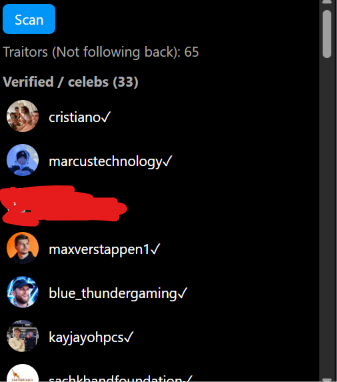
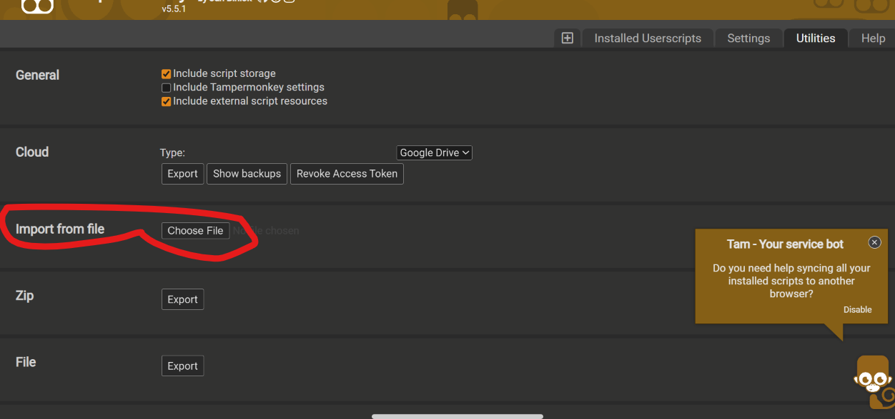

# Follow Back Checker

- A feature instgram shld have in the app itself, a userscript to check your follwoing and followers and shows who isnt following back
  - it checks b/w verified and not verified too
  - clicking on one , opens it in a new tab

- Only works on web

    

## Install

- 1. Install Tampermonkey/VioletMonkey browser extension 
- 2. Clcik on the tampermonkey icon  and press create new script
- 3. Copy the code from the `script.user.js` and replace the default code
- 4. Save 

 **OR**

- 1. Download `script.user.js`  from [releases](../../releases)
- 1. Install Tampermonkey/VioletMonkey browser extension 
- 2. Clcik on the tampermonkey icon  and press ON Dashboard
- 3. Go to `Utilities` tab and press on Choose File next to import from file

- 4. Select the downloaded file
- 5. Click on install

 **OR**

- 1. copy the code in `script.user.js` and paste it in console in developer tools

## Usage

1. Go to [instagram](https://www.instagram.com/)
2. Click on scan button in a panel in bottom right and wait
3. Click on any name to open profile in new tab

> [!IMPORTANT]
> The first time you scan, allow Tampermonkey to connect to `fbcdn.net`, otherwise profile pictures won't load.

> [!WARNING]
> This uses Instagram's unofficial endpoints and can break anytime. Automating Instagram can go against its terms, so use it at your own risk.